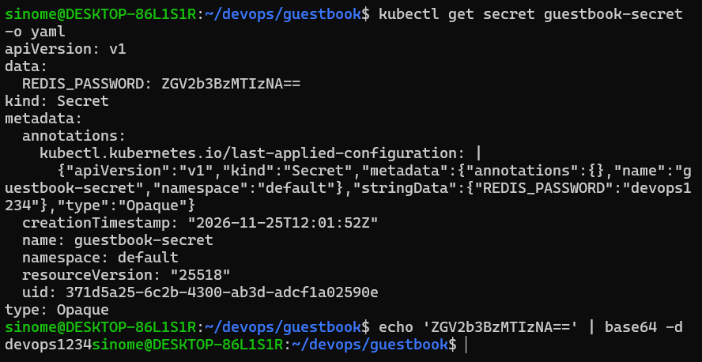
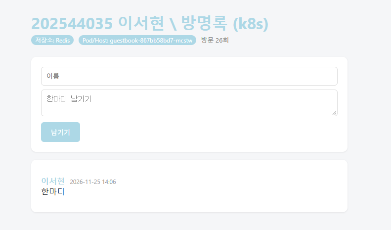
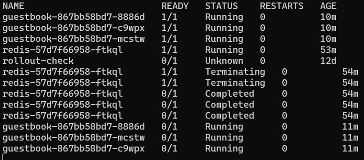
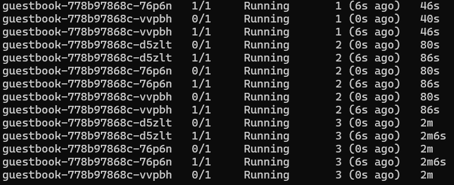

#11주차

## Secret

- Secret을 base64 -d로 읽은 사진 & 왜 안전하지 않을까? 

base64는 암호화가 아닌 단순 인코딩이기 때문 
누구든 base64 -d로 복원이 가능하다

## Test
- 나만의 방명록 화면

- readiness 실패 화면

- liveness 실패 화면

## 트러플슈팅

- 트러플슈팅은 문제를 찾아 원인을 분석하고  해결하는 과정이다.

## 3단 루팅
1. 가장 간단한 방식인 kubectl get pods로 상태를 확인하고 (READY)

2. kubectl describe pod pod이름 <= 을 사용해 가장 아래의 이벤트를 확인한다 

3. kubectl logs pod이름 <= 으로 로그 기록을 확인하여 에러 메시지를 확인하고 --previous를 붙혀 재시작 전 로그를 확인 할 수도 있다.

